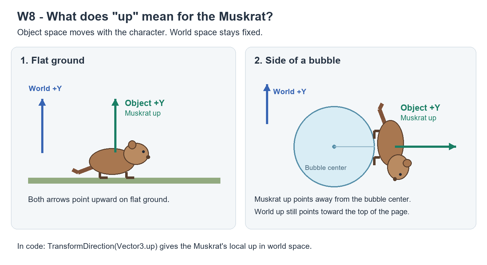

# in-class-activities
## Devlogs
### W1
I would spot the cat appearing on the camera, shifting the view to a second-person perspective.

https://qiliangw-sketch.itch.io/in-class-activity1
### W2
1. **Why are r, g, and b floats?** RGB channels use fractional values between 0.0 and 1.0, such as 0.1 and 0.3. Floats can store these values; ints store whole numbers, bools store true or false, and strings store text.

2. **Why is the bounce counter an int?** Each collision adds one whole bounce. An int represents this count directly; a float would allow unnecessary fractional counts, while bools and strings do not represent a numeric count appropriately.

3. **What does the Step 4 error tell us?** The original line `g -= 0.1f` is missing its terminating semicolon. The C# compiler reports CS1002, "; expected", indicating that the statement needs to end with `;`. The corrected line is `g -= 0.1f;`.

The W2 scene uses a circle sprite with initial RGB (0, 1, 0.3). Each collision increments the counter, changes the RGB channels with the required wrap conditions, and updates brightness using the average of the new RGB values. Completed Steps 1–9.

### W3 - In-Class Activity

#### Activity 1

1. I will use string GetResponse(int friendshipLevel, bool knowsSecret). The method returns the character's text response as a string. Favorability is a number, and knowing the secret is a yes or no condition.

2. I would use void SetLightDimness(float sanityPercent). Floats let sanity levels contain values between integer percentages. The method changes the lights directly, so it does not return anything.

3. I will use bool DidPlayerHitBeat(float keyPressTime). Input is when the player presses the key. The method can compare it to the expected time and allowed timing window stored in the class, and return true for a hit or false for a miss.

#### Activity 2

A class is like a recipe, and a component is a dish made from a recipe and added to a game object. Member variables are settings for a specific dish, such as its portion size or spice level. Methods are operations described by a recipe. Two dishes can use the same ingredients but have different settings, just like two balls can use BallW3 but have different colors and speed multipliers.

#### Activity 3

Because each quick bounce of the ball multiplies the ball color by 1.5, and the code never limits the RGB value to 1. After a few bounces, these values will grow rapidly, and values above 1 will appear brighter than normal colors.

### W4 - In-Class Activity

1. I added a CapsuleCollider (oriented along the Z-axis) to the cat and a SphereCollider to the soccer ball, and attached a Rigidbody component to both. The "Is Trigger" option is left unchecked for these colliders, allowing the cat to kick the ball and ensuring both objects can interact with the ground. The goal uses a BoxCollider with "Is Trigger" enabled; it does not require a Rigidbody because it remains stationary—it only needs to detect when the soccer ball enters, and the ball should be able to pass through it. The existing force field in the scene also functions as a trigger; the BounceOffWall scripts attached to the cat and the soccer ball ensure that whenever they exit the force field, they are bounced back toward the center of the play area.

2. During setup, the Rigidbody field for CatW4 was initially unassigned; I linked the Rigidbody component once it was added. I also assigned the respective Rigidbody components to the BounceOffWall scripts. I also verified that the goal is tagged as "Goal," ensuring that points are awarded only when the soccer ball enters the goal, rather than when it interacts with the force field. In testing, the cat is able to kick the ball; scoring a goal triggers a confetti effect, updates the score, and resets the timer. If the ball remains inside the goal, it does not continuously accumulate points; however, if it leaves and then re-enters, it will award another point.

Components diagram: [CatW4 ground contact and jumping](W4-components.svg).

### W6 — In-Class Activity (Week 5 scene)

#### DeerW5 plan

My plan was to give the deer two member variables: a Transform for the target and a NavMeshAgent reference. I used `[SerializeField]` for the target so I could drag an object into the Inspector. A Transform makes sense here because I need the object's position, and I can easily choose a different object later.

I only needed `Start()` for this part. It runs when the game starts, gets the NavMeshAgent with `GetComponent<NavMeshAgent>()`, and tells it where to go with `SetDestination(_target.position)`. The agent takes care of moving along the NavMesh, so I don't need to move the deer myself every frame. I attached the script to the Deer and picked the red mushroom as its target.

#### Cat movement

For the cat, I started with a zero vector in `Update()`. W adds `Vector3.forward`, and S adds `Vector3.back`. Then I use `Translate()` with the move speed and `Time.deltaTime` to move the cat. This way, the movement isn't based on how many frames the computer runs. If both keys are pressed, the two directions cancel each other out.

To flip the controls, I multiply the movement vector by -1 when `_flipWSControls` is checked. That switches W to backward and S to forward. I left it checked in the final scene to show this step. Unchecking it gives the normal controls again. A and D still turn the cat.

### W7 - In-Class Activity (W6 scene)

#### Class resource guide

For the resource guide, I worked on General C# coding, focusing on arrays and for loops. I added short notes about indexes, Length, and going through an array, along with links to the tutorials. My notes are in the Qiliang Wan tab and the first tab of the [shared Google doc](https://docs.google.com/document/d/1crDX6_ljdbrT8OOdQbNwN7QxS_CrQY8VUW1fGK32XYQ/edit?tab=t.octs2so8jfz6).

#### BatW6 plan

The bat needs a Transform for the cat, a speed value, and a bool to keep track of whether it is chasing. I used `[SerializeField]` for the cat and speed so they can be changed in the Inspector. Every bat in the scene has this component and points to the same cat.

I used Unity's `Update()` to move the bat toward the cat with `Vector3.MoveTowards()`. Multiplying speed by `Time.deltaTime` keeps movement consistent between frames. I wrote two public methods, `StartChasing()` and `StopChasing()`, so the manager can turn chasing on or off. These methods change the bool. The final bat script has no `Start()` method, so it does not automatically turn chasing on when the game starts.

#### Arrays and reactions

I put all ten bats in a `BatW6` array in the manager. A `for` loop checks the distance from each bat to the cat. If the bat is close enough, the manager tells it to chase. Otherwise, it tells the bat to stop. This lets the same code handle every bat instead of writing a separate check for each one.

The messages are stored in a string array. When a bat reaches the cat, `Random.Range(0, _messages.Length)` picks an index, and the existing reaction UI shows that message. The integer version of `Random.Range` leaves out the upper limit, so it will not choose an index past the end of the array.

I also made a float array with one timer for each bat. Another `for` loop adds `Time.deltaTime` to each timer. When a bat creates a message, only its timer resets. This stops it from creating a new message every frame while it stays next to the cat. The reaction text uses the provided `DestroyTimer` component to disappear after a short time.

#### Scene setup

I kept the W6 scene for this week's work, as the instructions explain. The chase distance is 4, the contact distance is 1, and each bat waits 0.5 seconds between messages. There are four messages in the Inspector. The cat uses left and right movement and Space to jump.

I checked all ten bats in Play mode. Nearby bats moved toward the cat, distant bats stayed still, and the bats stopped after leaving the chase range. I also checked two bats touching the cat at the same time. Both showed messages, waited for their own cooldown, and then showed another message from the array.

### W8 - In-Class Activity (W7 scene)

#### Coordinate spaces

#### What was wrong with Step 2?

In Step 2, the Muskrat kept moving along the world's Z axis, even after it turned. The code used `Vector3.forward` in world space, so moving forward did not follow where it was facing. I changed it to `transform.Translate` with `Space.Self`. Now W and S move it forward and backward based on its own direction.

## Open-Source Assets
### W1
- Animals: https://assetstore.unity.com/packages/3d/characters/animals/animals-free-animated-low-poly-3d-models-260727 
- Low-poly environment: https://assetstore.unity.com/packages/3d/environments/landscapes/low-poly-simple-nature-pack-162153 
